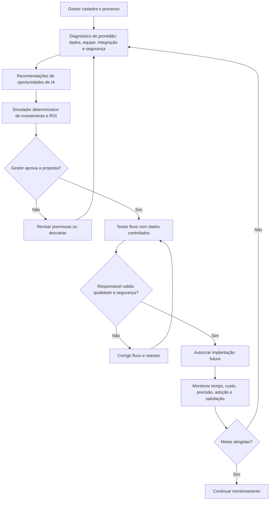

# Jornada do usuário — fluxograma do IMPULSO AI

**Integrantes:** Beatriz Ramos — RA 2025116740 · Nicole Santos Damaceno — RA 2025102325 · Victoria Maria de Carvalho Franca — RA 2025102342 · Kaua — nome completo e RA pendentes.

## Papéis e pontos de contato
| Etapa | Responsável | Indicador |
|---|---|---|
| Descrição de processo | Humano | Processos registrados |
| Diagnóstico | Regras e dados, com IA prevista | Tempo e qualidade dos dados |
| Oportunidades | IA prevista, revisão humana | Recomendações relevantes |
| Cálculo de ROI | Fórmulas determinísticas | ROI projetado e sensibilidade |
| Aprovação | Gestor | Propostas aprovadas |
| Testes e segurança | Supervisor humano | Testes aprovados, incidentes |
| Monitoramento | Painel e equipe | Tempo, custo, adoção, satisfação |

**Nota:** trata-se de fluxo conceitual. O protótipo publicado simula aprovações, mas não faz integrações reais.
